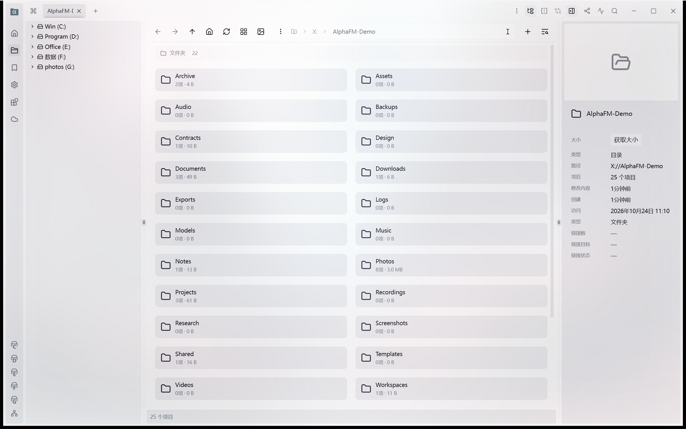

<!-- markdownlint-disable MD033 MD041 -->

**[English](README.md)** | **[中文](README.zh-CN.md)**

[](https://github.com/kizemo/alpha-file-manager/stargazers)
[](https://github.com/kizemo/alpha-file-manager/network/members)
[](https://github.com/kizemo/alpha-file-manager/issues)
[](https://github.com/kizemo/alpha-file-manager/releases/latest)
[](https://github.com/kizemo/alpha-file-manager/releases)
[](./LICENSE.md)
[](https://github.com/kizemo/alpha-file-manager/releases)

<h1>
  
  &nbsp;&nbsp;Alpha File Manager
</h1>

**一款面向 Windows 与 Linux 的现代文件管理器 —— 补上资源管理器最缺的两件事：
一棵真正的目录树，以及会跟着你跨应用走的文件对话框。**



Alpha File Manager 是 [Sigma File Manager](https://github.com/aleksey-hoffman/sigma-file-manager)
的独立衍生版本，由 [kizemo](https://github.com/kizemo) 维护。它跟随上游同步，并在其上叠加了
常驻目录树、跨应用的文件对话框路径同步、给 AI 助手用的内置 MCP 服务、
SFTP/FTP/FTPS 远程服务器、目录递归比较与同步、批量改名，以及一长串日常使用中的细节修复。

> [!IMPORTANT]
> **Alpha File Manager 是独立的社区项目**，与 Sigma File Manager 项目无隶属关系，
> 未获其认可或官方支持。基础应用的功能与品牌归
> [Aleksey Hoffman](https://github.com/aleksey-hoffman) 所有。

---

## ✨ 亮点

- 🗂️ **目录树一直在那儿** —— 跟着你正在用的那一格走，本地远程都一样，
  不用再手敲路径。
- ⚡ **Focus Sync** —— 任何 Windows 应用里的 *另存为* / *打开* 对话框，
  都开在你正在浏览的目录。零配置。
- 🔍 **并排比较两个目录，再按结果同步** —— 递归比较，准则跟专业工具同一套，
  并且有明确的「方向待定」，而不是猜哪边更新。
- 🤖 **内置 MCP 服务** —— 让 AI 助手用一套通用接口列盘符、浏览目录、搜索文件、读收藏。
- 🔐 **真正的远程服务器** —— SFTP、FTP、FTPS，主机密钥与证书固定，
  外加上传、下载、删除、改权限。
- 🧠 **批量改名不丢东西** —— 查找替换、大小写转换、模板与编号，
  带实时预览，冲突当场拦下而不是静默覆盖，还能撤销。

---

## 🧭 功能

### 浏览与整理

| | |
|---|---|
| 🗂️ | **常驻目录树** —— 跟着当前分栏走，远程时变成远程目录树，自己的展开状态也记得住 |
| 🗂️ | **标签页与分屏** —— 一个按钮左右互换，旁边还有「同步浏览」开关 |
| 🔎 | **智能全局搜索** —— 整盘搜索带拼写容错，目录内搜索是真的递归 |
| 🏷️ | **标记** —— 给文件与目录分组，仪表盘里分组展示且可编辑 |
| ⭐ | **收藏按分类** —— 添加时会问归到哪一类，分类可以改名、删除 |
| 🎚️ | **条目过滤** —— 按名称、大小、日期、类型等收窄一个大目录 |
| 🖼️ | **缩略图** —— 四档尺寸，只对视口内的内容按需生成 |
| 📐 | **按文件夹的布局** —— 列表还是网格，按位置决定，而不是全局一个开关 |

### 比较与同步

| | |
|---|---|
| 🔍 | **递归比较** —— 先看修改时间，再看大小，最后看内容校验和，与 WinSCP 同序 |
| 🧭 | **「方向待定」** —— 时间相同、内容不同：单独列出，绝不覆盖 |
| 📋 | **计划先于动手** —— 动手之前先给你看：每个会新建、复制、跳过的条目 |
| 🗑️ | **比较并同步永远不删东西** —— 带删除的镜像留到后面的版本 |

### 在远程服务器上干活

| | |
|---|---|
| 🔐 | **SFTP · FTP · FTPS** —— 主机密钥与 X.509 证书按主机与端口分别固定 |
| ⬆️⬇️ | **上传与下载** —— 传完之后，收到东西的那一格自己刷新 |
| 🗑️ | **删除,如实说** —— 只给一个「删除」，不给你假的回收箱，服务器拒绝就如实报 |
| 🔐 | **权限从列表里挑** —— 不用自己敲八进制 |
| 🌐 | **映射网络驱动器** —— 像资源管理器那样：挑共享、挑盘符 |

### 自动化与 AI 助手

| | |
|---|---|
| 🤖 | **内置 MCP 服务** —— 六个只读工具：盘符、目录列表、搜索、体积、收藏、可挂载设备 |
| ⚡ | **六家助手一键部署** —— Codex、Cursor、Claude Code、Claude Desktop、OpenClaw、Minimax Code |
| 🔒 | **默认就是加固的** —— 只监听本机、随机访问密钥、每次调用都重新检查权限 |
| 🔌 | **扩展与扩展市场** —— 扩展可以加命令、加页面、加快捷键、加设置项 |
| ⌨️ | **快捷键与命令面板** —— 大部分操作都能用键盘完成 |

### 外观与体验

| | |
|---|---|
| 🎨 | **背景视觉效果** —— 自定义图片与视频，支持 Photoshop 式混合模式 |
| 🖼️ | **快速查看** —— 按 `Space` 预览图片、视频、音频、PDF 与文本，不用离开应用 |
| 📦 | **Zip 压缩包** —— 压缩与解压都在应用内完成 |
| 🪟 | **可以接管资源管理器** —— 在 Windows 上注册为默认文件管理器 |

---

## 📸 界面

| | |
|---|---|
|  | **快速访问** —— 收藏按分类分组，带缩略图、大小与「X 小时前」 |
|  | **仪表盘** —— 收藏、标记、常用、历史都在一处 |

---

## ⚖️ Alpha File Manager vs Sigma File Manager vs Windows 资源管理器

三样东西，三种活法。下面是它们之间**如实**的对比。

| | | Alpha File Manager | Sigma File Manager | Windows 资源管理器 |
|---|---|---|---|
| 🖥️ | **跑在哪** | Windows + Linux | Windows + Linux | 只有 Windows |
| 🌲 | **左侧目录树** | ✅ 常驻的一棵树，跟着你正在用的那一格走 —— 远程也能成树 | ➖ 没有 | ✅ 在导航窗格里 |
| ⭐ | **常用文件夹一键直达** | ✅ 收藏按分类分组、可以编辑，添加时还会问「归到哪一类」，常用集合一点就进 | ➖ 没有分类，添加时也不问 | ➖ 只能钉在「快速访问」，没有分类 |
| ⚡ | **别的应用里的文件对话框** | ✅ **Focus Sync** —— 任何对话框都开在你正在浏览的目录 | ➖ | ❌ |
| 🤖 | **让 AI 助手驱动它** | ✅ 内置 MCP 服务，六家助手一键部署 | ❌ | ❌ |
| 🔐 | **远程服务器** | ✅ SFTP · FTP · FTPS，主机密钥与证书固定 | ❌ | ➖ SMB / WebDAV / OneDrive，压根没有 SFTP |
| 📤 | **在远程文件上干活** | ✅ 上传、下载、删除、改权限 | ❌ | ➖ 只有网络共享 |
| ↔️ | **两格并排着用** | ✅ **一个按钮左右互换**，旁边还有**「同步浏览」开关** —— 进入一个目录，另一格跟着走，往上退一级也带着它 | ➖ **没有左右互换**；联动分屏有，但埋在导航器的选项菜单里 | ➖ 是标签页，不是并排两格 |
| 🔍 | **比较两个目录** | ✅ 递归比较，准则跟专业工具同一套 —— 并且有明确的「方向待定」，而不是猜哪边更新 | ➖ | ➖ 只比大小与日期，选项藏得很深 |
| 🧠 | **批量改名** | ✅ 查找替换、大小写转换、模板与编号 —— 带实时预览，冲突当场拦下而不是静默覆盖，还能撤销 | ❌ Sigma 里根本没有这个功能 | ✅ 有查找替换，也带预览 |
| 🫳 | **把文件拖到别的程序里** | ✅ **按住文件就能拖出去** —— 微信、钉钉、浏览器都行，而且拖的那个窗口待在后台不抢前台 | ➖ | ✅ |
| 👁️ | **拖的时候目标程序提到前面** | ✅ 鼠标停在哪个应用上，哪个窗口就替你带到前面，落点一眼就看见 | ➖ | ➖ Windows 的拖拽不会把目标窗口提到前面 |
| ⌨️ | **键盘连选** | ✅ **Shift + 方向键**从你起手的锚点往外扩选 | ➖ | ✅ Shift + 方向键也能扩选 |
| 📊 | **显示哪些列** | ✅ 按位置决定 —— 「位置」页会去掉那些根本没话说的列 | ➖ 所有目录一套列 | ➖ 所有目录一套列 |
| 💾 | **盘用了多少** | ✅ 卡片上直接填充，还有一列「可用空间」 | ➖ | ✅ |
| 🖼️ | **缩略图尺寸** | ✅ 四档可选 | ➖ | ➖ 跟随系统 |
| 🌐 | **映射网络驱动器** | ✅ 从侧边栏就能做，盘符自己挑 | ➖ | ✅ |
| 🎨 | **背景效果支持混合模式** | ✅ Photoshop 的图层模式全套，还能配自己的填充色 | ➖ | ❌ |

✅ 有 · ➖ 这个项目里没有 · ❌ 做不到

> **你想要的是「Windows 自带的那个」** —— 要 Shell 扩展、要编解码器、要网络共享、要 EFS 加密，
> 还要那种「跟什么都能对上」的踏实感，那就用资源管理器。任何第三方文件管理器都替代不了这一点，
> 我们也不会假装可以。
>
> **你想要的是「一个窗口里，本地磁盘和远程服务器并排待着」** —— 助手还能通过一套通用接口读你的盘，
> 目录树能跟着你走进其中任何一边，这就是 Alpha File Manager。资源管理器不带 SFTP 客户端，
> 也不存在「让助手看见你的文件」这件事，除非你再装一个第三方桥接。
>
> **Sigma File Manager** 是我们构建时用的底座。想要上游项目本身、它自己的发版节奏和它的社区，
> 就去用它。Alpha File Manager 是它的独立衍生版本，并且一直跟着上游同步。

---

## 📦 下载与安装

**主要下载入口：** [**www.aiec.fun/alpha-file-manager**](https://www.aiec.fun/alpha-file-manager/)
—— 应用自己检查更新的也是这个通道。

| | 平台 | 怎么装 |
|---|---|---|
| 🪟 | **Windows** | 一步式安装包，见[下载页](https://www.aiec.fun/alpha-file-manager/) —— 可安装、可原地升级、可彻底卸载 |
| 🪟 | **Windows 便携** | 同一个安装包也支持按用户安装，全程不需要提权 |
| 🐧 | **Linux** | 从源码构建（`.deb` / `.AppImage`），见[从源码构建](#-从源码构建) |

GitHub Releases 里放的是同一个安装包，作为备用镜像：
[releases/latest](https://github.com/kizemo/alpha-file-manager/releases/latest)。

> **Windows 版本未做代码签名**，所以 SmartScreen 会提示「未知发布者」——
> 点「更多信息 → 仍要运行」。原地升级会保留你的设置、扩展与窗口布局。

---

## 🆕 3.5.0 新增了什么

### 🔍 比较两个目录，撞上读不了的目录不再整个罢工

**修复。** 以前比较两个目录时，只要撞上一个没权限读的子目录，**整个比较就直接失败**。
Windows 上这类目录不少 —— 回收站、任何正被别的程序占着的目录 —— 而一棵真实的目录树里全是它们，
所以实际上比较多半是报错收场，而不是给出结果。现在读不了的目录会被**跳过**，
数量在摘要里写明，比较继续进行。

### ⚡ 比较大树快了约五十倍

**改进。** 收集两侧数据占了 **93% 的时间**，慢的原因只有一个：每个条目的元数据
都要把绝对路径重新拼一遍再问一次，而在 Windows 上这比直接问目录项贵大约一百倍。
现在元数据直接来自目录项，并且**四个 worker 并行收集**。

同一台机器、同样一万个条目：**以前 1.18 秒，现在 23 毫秒。**
测量按**两个顺序各跑一遍**，任何一方都没能靠缓存占便宜。

### 📊 比较的时候终于有进度了

**新增。** 走一棵大树是要花时间的，而对话框以前只转一个圈 ——
你分不清它是在干活还是卡住了。现在它会说明**正在读哪一侧**、已经过了多少条目，
以及比较本身进行到哪一步。

### 🗑️ 删大树时进度条终于说实话了

**修复。** 删除进度条以前统计的是**你选中的顶层条目**，
所以删一个装着 25 万个文件的目录，进度条只是最后从 0% 跳到 100%。
现在它按**真正删掉的条目数**推进，旁边再显示释放出的空间。
取消会在**每个文件之前**检查一次，并且最多四个子树并行删除。

> 完整历史 —— 每一个版本、每一处修复 —— 见
> [CHANGELOG](CHANGELOG.md) 与
> [Releases 页面](https://github.com/kizemo/alpha-file-manager/releases)。

---

## 👥 社区

| | |
|---|---|
| 🌐 | **官网** —— [www.aiec.fun/alpha-file-manager](https://www.aiec.fun/alpha-file-manager/) |
| 💬 | **讨论区** —— [提问、提想法](https://github.com/kizemo/alpha-file-manager/discussions) |
| 🐛 | **问题反馈** —— [报 bug](https://github.com/kizemo/alpha-file-manager/issues) |
| 🧑‍💻 | **参与贡献** —— [CONTRIBUTING.md](CONTRIBUTING.md) |

> **如果 Alpha File Manager 对你有用，点一个 star 能让更多人找到它。**
> GitHub 只会把一个项目展示给「搜到它的人」和「看见别人分享它的人」，
> 而 star 是让它同时被这两边看见的最省力的办法。

---

## 💻 从源码构建

Alpha File Manager 是一个 [Tauri v2](https://v2.tauri.app/) 应用：
Rust 后端（`src-tauri/`）与 Vue 3 + TypeScript 前端（`src/`）。

```bash
git clone https://github.com/kizemo/alpha-file-manager.git
cd alpha-file-manager
npm ci --ignore-scripts
npm run tauri:dev          # 开发
npm run check              # lint + 类型检查 + 测试
npm run tauri:build        # 发布构建
```

环境准备与完整流程见 [CONTRIBUTING.md](CONTRIBUTING.md)。

---

## 致谢

- **上游：** [aleksey-hoffman/sigma-file-manager](https://github.com/aleksey-hoffman/sigma-file-manager)
  by [Aleksey Hoffman](https://github.com/aleksey-hoffman)。基础应用、它的功能与品牌归上游所有。
- **Focus Sync 扩展：** 就在本仓库的
  [`extensions/kizemo.focus-sync/`](./extensions/kizemo.focus-sync/) 下 ——
  扩展载荷、sidecar 源码与独立安装器。单独发布的安装包归档在
  [kizemo/focus-sync](https://github.com/kizemo/focus-sync)。
- **本衍生版本的维护者：** [kizemo](https://github.com/kizemo)

按原条款复用的一小部分代码：
[inaku-Gyan/PathWrap](https://github.com/inaku-Gyan/PathWrap)（MIT）·
[QwenLM/qwen-code](https://github.com/QwenLM/qwen-code)（Apache-2.0）。

---

## 许可证

**GPL-3.0-or-later** —— 许可证全文见 [`LICENSE.md`](./LICENSE.md)，
版权声明与一段大白话摘要见 [`NOTICE.md`](./NOTICE.md)。
本仓库的衍生改动同样按该许可证贡献。

按 GPL-3 的要求，每个已发布二进制对应的源码都在这里：

| 组件 | 源码 |
|---|---|
| Alpha File Manager（本衍生版本） | <https://github.com/kizemo/alpha-file-manager> |
| Sigma File Manager（底座） | <https://github.com/aleksey-hoffman/sigma-file-manager> |
| Focus Sync 扩展 + sidecar | 随本仓库分发，`extensions/kizemo.focus-sync/` |
