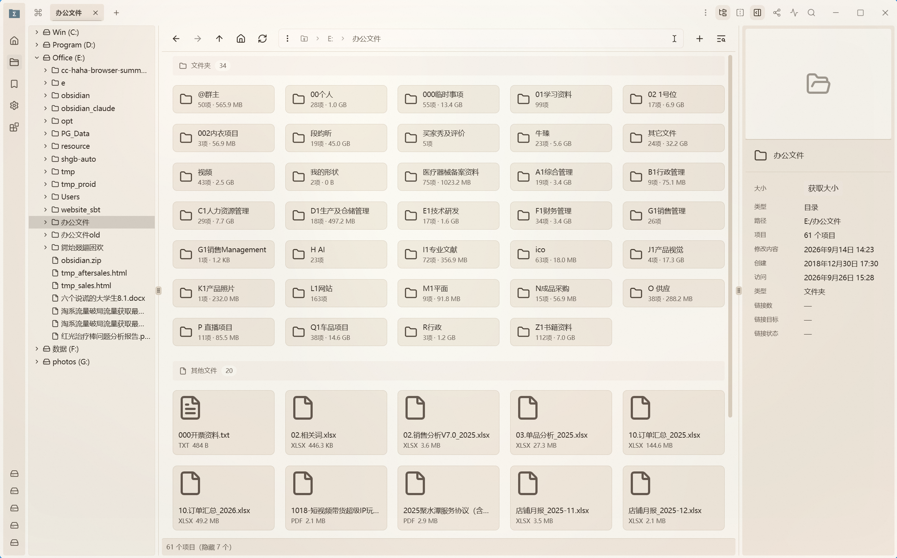

**[English](README.md)** | **[中文](README.zh-CN.md)**

<h1>&nbsp;&nbsp;Alpha File Manager</h1>

**一款面向 Windows 与 Linux 的现代文件管理器 —— 补上资源管理器最缺的两件事：
一棵真正的目录树,以及会跟着你跨应用走的文件对话框。**

Alpha File Manager 是 [Sigma File Manager](https://github.com/aleksey-hoffman/sigma-file-manager)
的独立衍生版本,由 [kizemo](https://github.com/kizemo) 维护。它跟随上游同步,并在其上叠加了
一棵目录树、跨应用的文件对话框路径同步,以及一长串日常使用中的细节修复。

> [!IMPORTANT]
> **Alpha File Manager 是独立的社区项目**,与 Sigma File Manager 项目无隶属关系,
> 未获其认可或官方支持。基础应用的功能与品牌归
> [Aleksey Hoffman](https://github.com/aleksey-hoffman) 所有。

---

## ✨ 我们在 Sigma File Manager 之上加了什么

下面这些全部由我们实现,上游没有任何一条。

| | 功能 | 起始版本 |
|---|---|---|
| ⌨️ | **地址栏按资源管理器的方式工作** —— 打开即整条选中，粘一条路径按回车直接进 | **3.2.4** |
| ↔️ | **分屏两格左右互换** —— 搜索框旁边一个按钮 | **3.2.4** |
| 📐 | **窄窗口菜单里也有缩略图大小** —— 以前窗口一窄它就消失 | **3.2.4** |
| 🤖 | **内置 MCP 服务** —— 让 AI 助手用一套通用接口读盘符、浏览目录、搜索文件 | **3.2.1-beta** |
| ⚡ | **六家助手一键部署** —— Codex、Cursor、Claude Code、Claude Desktop、OpenClaw、Minimax Code | **3.2.1-beta** |
| 🗂️ | **目录树侧边栏** —— 常驻,跟随当前激活面板 | 2.2.x |
| ⚡ | **Focus Sync** —— 所有文件对话框跟随你正在浏览的目录 | 2.2.x |
| 🧭 | **目录树右键菜单** —— 6 个操作项 | **3.1.0** |
| 🎚️ | **按文件夹的布局切换**,移入选项卡工具栏 | **3.1.0** |
| 🖼️ | **四档缩略图尺寸** —— 24 / 32 / 48 / 54 像素 | **3.1.0** |
| 🧹 | **缩略图缓存占用可见 + 一键清理** | 3.0.2 |
| 🔀 | **混合排序开关** | 3.0.2 |
| ✅ | **框选默认开启** | 3.0.2 |
| 🧠 | **批量改名数据丢失修复** —— 不再静默覆盖 | 3.0.1 |
| 📦 | 一步式安装、原地升级、彻底卸载 | 3.0.0 |

---

## 🆕 3.2.4 新增了什么

**3.2.4 是 3.2 系列的第一个正式版。** 地址栏按资源管理器的方式工作了,分屏可以
左右互换,缩略图大小在窗口变窄时也找得到。它取代 3.2.1-beta —— 那是最后一个
测试版。

### ⌨️ 地址栏按资源管理器的方式工作

点一下地址栏,它就原地变成输入框,当前路径**整条选中**;粘一条新路径按回车,
直接进那个地方。以前光标落在末尾,粘贴会追加在旧路径后面,拼出一个「旧路径 +
新路径」的诡异结果;想在原路径后面续写,按一下 End 就行 —— 资源管理器也是
这么做的。

三个缺陷是一起修掉的,任何一个单独存在都足以让「粘一条路径」变得不可靠:

- **只有末尾带斜杠的路径才被当成目录。** `D:\photos\2026` 不带结尾斜杠,
  回来的会是一条搜索结果而不是那个文件夹本身。像 `photos` 这样的裸词仍然
  按名字搜,按名称查找的行为没有变化。
- **回车不再等列表刷新。** 刚粘完的一小段时间里候选列表还没刷新好,这时候
  按回车以前是什么都不做。现在直接以输入框里的内容为准,立刻生效。
- **方向键仍然优先。** 用方向键选中某个文件再按回车,打开的仍然是那个文件 ——
  输入框里的路径不会覆盖你的选择。

### 🌲 候选列表读起来是一棵小树

第一行就是你正指向的目标目录:顶格、字重更重,打开时就选中,按回车直接进去。
子目录和文件统一缩进一格、彼此齐平,左侧一根竖线串下来,每行一条短横线指向
图标,最后一行收尾。目录排在文件前面,各自按名称排序。

### ↔️ 分屏两格可以左右互换

开着两格时,**每格工具栏**的搜索框右侧有一个左右互换按钮,点一下两格就此对调 ——
**只换文件夹**,两格各自的窗口宽度、以及在标签组里的先后顺序都保持不变。
两格本来就开着同一个文件夹时什么也不会发生,这是刻意的。

### 📐 窄窗口下也找得到缩略图大小

窗口宽度不足 600px 时,工具栏会折叠成一个「⋯」菜单。缩略图大小此前**只加在
宽屏那排图标上**,所以窗口一收窄,这个功能就等于消失了 —— 不是藏得深,是真的
没有。现在「⋯」菜单里也有它,排在同名的那一项之后,两处打开的是同一个弹窗。

> **仍然是只读的。** 3.2.1-beta 引入的 MCP 服务原样保留,本版本没有任何功能能
> 移动、改名或删除你的文件。

---

## 🆕 3.2.1-beta 新增了什么

**3.2.1-beta 是 AI 版本：文件管理器内置了 MCP 服务,助手可以直接读你的硬盘,
不必再靠截图猜。**

### 🤖 助手现在能直接问你的文件管理器

[Model Context Protocol](https://modelcontextprotocol.io)（MCP）是 Claude、Codex、
Cursor 以及越来越多助手本来就会说的接口。在「设置 → 实验性功能」里打开服务,
它们就能列出盘符、浏览目录、按文件名搜索、算目录占多大、读你的收藏 ——
而且走的是**已经认识快捷方式、虚拟目录和网络共享**的那个文件管理器。

**6 个工具,全部只读。** 移动、改名、复制、删除一个都做不到,而且写操作
不是「默认关着」,是**根本没实现**。

| 工具 | 它回答的是 |
| --- | --- |
| `list_directory` | 这个目录里有什么？ |
| `get_drives` | 本机有哪些盘,各剩多少空间？ |
| `get_mountable_devices` | 哪些 U 盘和共享可以连接？ |
| `search_files` | 叫这个名字的文件在哪？ |
| `get_directory_size` | 这个目录连子目录一共占多少空间？ |
| `get_favorites` | 这个人收藏了什么？ |

### 🔒 三道防护,一道都不能关

- **只监听本机。** 服务只绑 127.0.0.1,局域网里别的设备即使知道地址也连不上。
- **随机访问密钥。** 第一次打开服务时生成,不带它的请求一律拒绝。
- **拒绝陌生网址发来的请求。** 只接受来自本机地址的访问。

四个权限档位,而且**每次调用都会重新查一遍** —— 调低档位在下一次请求就生效,
不用重连。

### ⚡ 一键装进各家助手

照抄一段 JSON 到别人家的配置文件里,最容易出的错就是少一个逗号 —— 助手的反应
只是「没有配置任何服务」,什么线索都不给你。「设置 → 实验性功能 → MCP 服务」
现在会列出本机上能识别到的助手,写明**每一家的配置文件放在哪**,一键替你写好;
同一个界面也能一键移除。

因为改的是**你自己的**配置文件,写入守三条规矩：

- **只合并,不重写。** 先解析文件,只增删那一个条目,再写回 —— 文件里别处的设置,
  包括 Codex `config.toml` 里的注释,都保持原样。
- **读不懂就不写。** 解析失败的文件原封不动并明确报错,而不是替换成一份
  看起来对、其实不是的内容。
- **每次写之前先备份**,存成 `<原文件名>.alpha-mcp.bak`。

写入之后需要重启对应的助手才会生效,所以面板上会常驻一条提示,写明改了哪个文件、
备份放在哪里。

### 📜 谁问过什么,都会记下来

每次调用都写进应用设置目录旁边的日志：调用的是哪个工具、时间、是放行还是拒绝。
纯文本,想核对就用记事本打开。

### 🧪 这是测试版

只提供读取操作,这是刻意的。权限模型和配置面板在正式版前仍可能调整,
各语言的界面文案也未必都已定稿。

---

## 🆕 3.1.0 新增了什么

**3.1.0 收录的是我们把软件改名为 Alpha File Manager 之后新增的全部内容。**
3.0.0 是品牌化正式版,3.0.1 修复了批量改名的数据丢失,3.0.2 加入列表缩略图,
本版本是建立在这些之上的打磨。

### 🧭 导航

- **目录树有了右键菜单。** 在任意节点上右键 —— 盘符、目录、文件 —— 弹出
  **复制、剪切、粘贴、重命名、打开所在目录、属性**。剪贴板里确实有内容时
  「粘贴」才会出现。「重命名」复用文件列表同一套对话框,无论从哪里触发,行为完全一致。
- **布局切换按钮移到选项卡工具栏**,紧挨着刷新按钮,并且改为**只作用于当前文件夹**
  而非全局。同一个目录的两个选项卡现在可以各用各的布局,切换选项卡也不会再互相覆盖。
  如果你更习惯原来的全局路径,折叠的 ⋮ 菜单里「仅此文件夹」仍然保留。
- **磁盘同时显示空余空间与总空间。** locations 里的磁盘条目显示
  `147.1 GB / 931.3 GB`,不再显示条目计数。

### 🖼️ 缩略图

- **四档缩略图尺寸。** 小(24 像素)、中(32 像素)、大(48 像素)、超大(54 像素) ——
  可在选项卡工具栏或**「设置 → 常规 → 文件视图」**中选择。行高随档位联动
  (42 / 42 / 64 / 70 逻辑像素),切换档位时列表不会错位。
- 缩略图**按需生成**:只为滚动到可见区域的行生成。

### 🏠 主页与设置

- **主页标题移出主题图**,放在图外并放大到可读尺寸。点击主题图本身则直接打开背景管理。
- **设置页补上官网与源码仓库链接。** 顶部介绍改为描述**本版本**在 Sigma File Manager
  之上增加了什么,而不是上游的通用简介。

### 🔧 修复

- **Focus Sync 在应用运行几分钟后会"哑掉"。** 伴生进程把一次**被拒绝**的写入也记成了
  「已写入」,结果把自己的重试通道永久关闭 —— 于是一次早期失败之后,后续所有路径变化
  都被忽略,直到你关掉对话框重新打开。现在写入失败不再被记成成功。
- **扩展加载器拒绝了我们自己的扩展。** 代码扫描器把内置扩展里一句英文**注释**中的
  `self` 当成了违规,于是 Focus Sync 在 Worker 启动之前就被拒绝 —— 这正是路径同步
  看起来"整体失效"的原因。扫描器现在会跳过注释与字符串字面量,同时也仍然拦截
  可执行代码里的真实违规。
- **目录树右键的复制 / 剪切签名错误**,剪贴板拿不到内容。

### 📦 安装器

- 升级与卸载现在会**结束整个应用进程树**,残留的辅助进程无法再占住文件导致安装中断。

> **版本脉络:** 2.2.x → **3.0.0** 品牌化 → 3.0.1 改名数据丢失修复 →
> 3.0.2 列表缩略图 → **3.1.0** 本版本。

---

## 🗂️ 目录树侧边栏

左侧常驻**目录树**,实时映射文件系统并跟随当前激活面板 —— 你能看清所在位置的层级结构,
也能一键跳到任意上级目录。

- **始终一键可达** —— 导航工具栏上有独立的 `FolderTree` 按钮,刻意**不**放进布局下拉菜单。
- **跟随一切** —— 自动跟随地址栏、收藏面板,以及**分屏视图中的激活面板**;每个分屏各自维护展开状态。
- **始终紧凑** —— 导航时只保留当前路径的祖先链展开,其余分支自动折叠。
- **点击语义可预期** —— 点击行内容进入该目录;点击折叠箭头只展开,不改变当前目录。
- **盘符不混淆** —— 根节点同时显示卷标与盘符(如 `Win (C:)`),多硬盘与 WSL 环境下也一目了然。
- **可右键操作** —— 即上文所述的六项菜单。
- **记住你的选择** —— 显示 / 隐藏状态跨重启保存。

对应上游 issue [#499](https://github.com/aleksey-hoffman/sigma-file-manager/issues/499)。

---

## ⚡ Focus Sync —— 会跟着你走的文件对话框

在 Alpha FM 里浏览到某个目录,然后在**任意** Windows 应用里打开
**另存为 / 打开**对话框 —— Chrome 下载、Word、VS Code、钉钉、飞书 ——
它已经停在你刚才那个目录里了。

**零配置。** 安装包已内置扩展与一个小型本地伴生进程,Windows 计划任务会在登录时自动启动。
**不需要手动运行任何东西。**

**它给自己定的三条规矩**

| | |
|---|---|
| **绝不抢焦点** | 对话框不在前台时,写入会等待,绝不强行切换。 |
| **绝不弄脏文件名框** | 目标是地址栏。当回退路径必须碰文件名框时,它会还原原始值并**读回校验**后才提交。 |
| **绝不写入陈旧路径** | 若 Alpha FM 未在运行,则拒绝写入,而不是把你上次待过的目录灌进对话框。 |

扩展只申请 `commands`、`toolbar`、`notifications`,以及对 `127.0.0.1` 的 HTTP 访问 ——
**无 shell 权限,无文件系统权限。**

> **状态** —— 仍在加固中。已在原生 Win32 对话框上验证;
> Chromium 与 UWP 宿主的表现因宿主而异。

---

## 📦 获取

**主下载源:** [**www.aiec.fun/alpha-file-manager**](https://www.aiec.fun/alpha-file-manager/)
—— 应用自身的更新检查也走这个渠道。

**GitHub Releases** 存放同一份安装包,作为兜底镜像。

Windows 构建未做代码签名,SmartScreen 会提示「未知发布者」—— 选择
**更多信息 → 仍要运行** 即可。原地升级会保留你的设置、扩展与窗口布局。

---

## 致谢

- **上游:** [aleksey-hoffman/sigma-file-manager](https://github.com/aleksey-hoffman/sigma-file-manager),
  作者 [Aleksey Hoffman](https://github.com/aleksey-hoffman)。基础应用本身、其功能与品牌归上游所有。
- **Focus Sync 扩展:** 位于本仓库的
  [`extensions/kizemo.focus-sync/`](./extensions/kizemo.focus-sync/) ——
  含扩展载荷、sidecar 源码与独立安装器。单独发布的安装包归档在
  [kizemo/focus-sync](https://github.com/kizemo/focus-sync)。
- **本分支维护者:** [kizemo](https://github.com/kizemo)

另按原始条款复用以下代码:
[inaku-Gyan/PathWrap](https://github.com/inaku-Gyan/PathWrap)(MIT) ·
[QwenLM/qwen-code](https://github.com/QwenLM/qwen-code)(Apache-2.0)。

---

## 许可证

**GPL-3.0-or-later** —— 详见 [`LICENSE.md`](./LICENSE.md)。本分支新增内容同样以该许可证发布。

按 GPL-3 要求,所分发二进制对应的完整源码可获取:

| 组件 | 源码 |
|---|---|
| Alpha File Manager(本分支) | <https://github.com/kizemo/alpha-file-manager> |
| Sigma File Manager(基础应用) | <https://github.com/aleksey-hoffman/sigma-file-manager> |
| Focus Sync 扩展 + sidecar | 本仓库内 `extensions/kizemo.focus-sync/` |