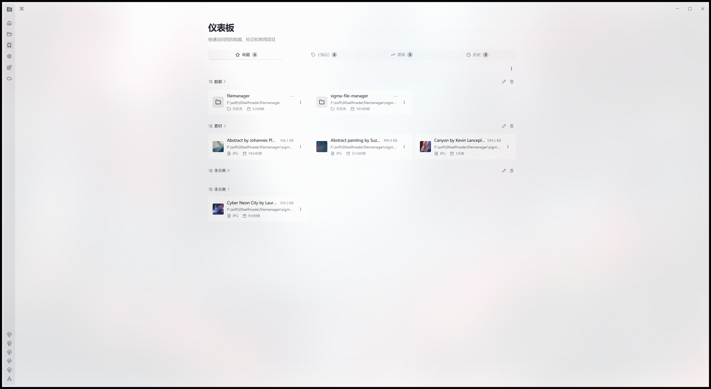
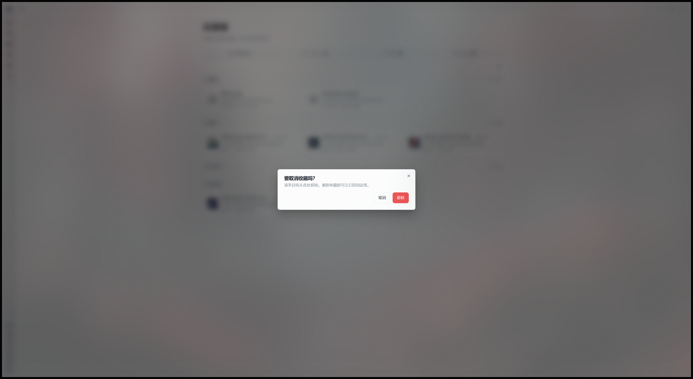
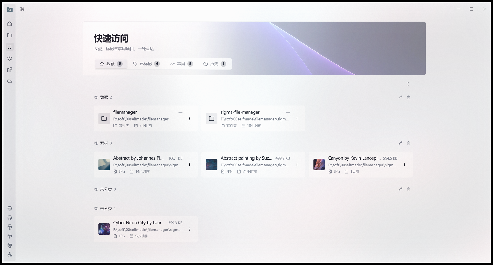
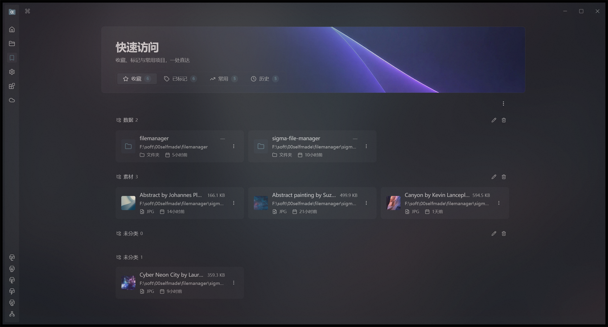
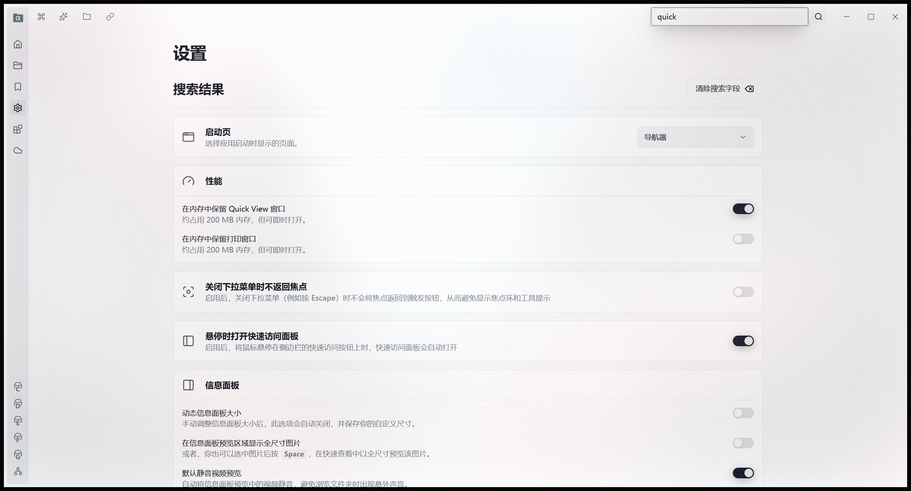
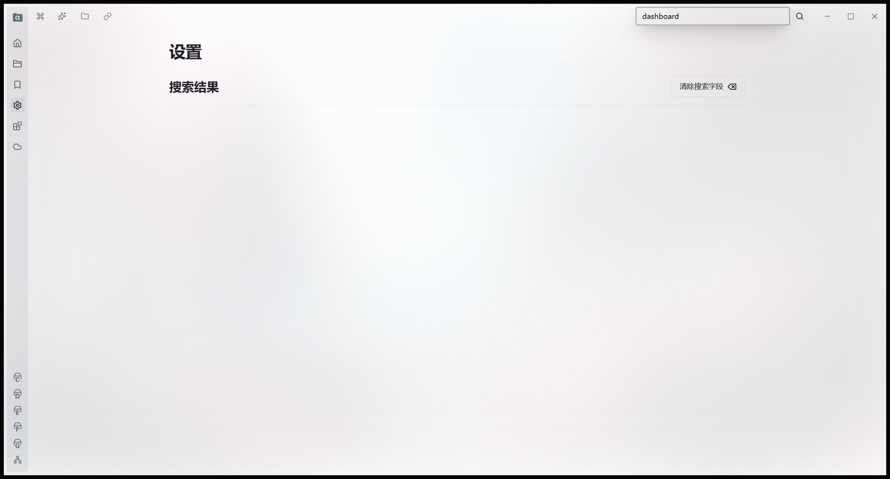

# 交接文档：仪表盘卡片增强 + Hero 顶部区 + 板块改名（upstream 仪表盘改版 · 第一、二阶段）

> 日期：2026-10-23
> 仓库：`F:\soft\00selfmade\filemanager\sigma-file-manager`（origin `kizemo/alpha-file-manager`）
> 上游：`aleksey-hoffman/sigma-file-manager`（本机远端名 `upstream`）
> **当前状态：四项低风险能力 + Hero 顶部区（方向 C · 沉浸封面）+ 板块改名「仪表板 → 快速访问」已落地并接线，门禁全绿。**
>
> 上游背景见 `docs/handoff-2026-10-23-upstream-sync-and-dashboard-review.md`
> （分叉分析、12 条冲突清单、难度分级、upstream 真机截图）。

---

## 0. 一句话结论

按「**按能力逐项移植，不整体替换页面骨架**」的约定，本轮落地了四项**只加信息、不动骨架**的能力，
外加一块 **Hero 顶部区**（upstream 的新版式，但高度压低、计数卡换回本仓的胶囊页签）：

| 能力 | 结果 |
|---|---|
| 条目大小 | 卡片文件名右侧显示大小（文件逐个 stat、目录走批量统计），取不到显示「—」 |
| 相对时间 | 卡片路径下方显示「类型 + 添加于 X 前」 |
| 缩略图预览 | 图片/视频进入视口后显示真实缩略图，离开视口取消请求 |
| 确认框体系 | 清空列表 / 删标记 / 取消收藏 / 移除标记 先弹确认框 |
| Hero 顶部区 | upstream 的背景图 + 标题版式（方向 C · 沉浸封面，封面图向下不淡出）；页签仍用本仓胶囊；左侧边栏原样不动 |
| 板块改名 | 全部用户可见 UI 文案「仪表板」→「快速访问」（8 个 key × 17 语言） |

**页面骨架、标签页结构、收藏分类分组、卡片点击行为全部保持原样。**

---

## 1. 移植判据：这一轮搬了什么、没搬什么

上一轮定下的判据是「**只搬 AFM 已内联同一套逻辑的模块**」，本轮沿用并细化成三条：

1. **纯函数优先** —— 能独立成模块的先成模块（大小格式化、相对时间）；
2. **有真实调用方才搬** —— 搬进来的代码必须在这一轮就接上线，不能是「等以后用」的死代码；
3. **不动骨架** —— 不引入 upstream 的 list/grid 双布局、不引入侧栏、不换页签结构。

### 1.1 新增文件

| 文件 | 来源 | 说明 |
|---|---|---|
| `src/utils/dashboard-item-size.ts` | upstream `3eca4c17` | 两个纯函数：文件大小、目录大小格式化 |
| `src/utils/dashboard-relative-time.ts` | upstream `3eca4c17` | 相对时间格式化（翻译函数由调用方注入） |
| `src/modules/dashboard/composables/use-dashboard-item-sizes.ts` | upstream `3eca4c17` | 大小采集：文件逐个 stat、目录走 `useDirSizesStore` 批量 |
| `src/modules/dashboard/composables/use-dashboard-entry-previews.ts` | upstream `3eca4c17` | 缩略图助手的 provide/inject 层 |
| `src/modules/dashboard/composables/use-dashboard-entry-preview.ts` | upstream `3eca4c17`（**有改动**） | 单卡片缩略图：IntersectionObserver + 取消请求 |
| `src/modules/dashboard/components/dashboard-tagged-item-meta.vue` | upstream `3eca4c17`（**有改动**） | 卡片底部的「类型 + 相对时间」一行 |
| `src/modules/dashboard/components/dashboard-confirm-dialog.vue` | upstream `3eca4c17` | 通用确认框壳子（标题/描述由调用方给） |
| `src/modules/dashboard/components/dashboard-hero.vue` | upstream `3eca4c17`（**有改动**） | Hero 顶部区（方向 C · 沉浸封面），四处理意差异见 6.3 |
| `src/assets/media/dashboard/dashboard-top-bg.jpg` | upstream `3eca4c17` | Hero 封面图（69,249 字节） |
| `src/localization/__tests__/quick-access-rename.test.ts` | 本轮自写 | 板块改名门禁：13 个必需 key + 全量旧名扫描（4 例） |

### 1.2 改动文件

| 文件 | 改动 |
|---|---|
| `src/modules/dashboard/components/entry-card.vue` | 加 `sizeLabel` prop、缩略图渲染位、`#meta` 插槽 |
| `src/modules/dashboard/pages/dashboard.vue` | 接线四项能力 + 确认框状态机；页签挪进 Hero 并改玻璃态 |
| `src/localization/messages/*.json`（17 个） | 新增 9 个确认框文案 key；改名 13 个 key（见第 7 节） |

### 1.3 刻意**没有**搬的部分（以及原因）

| upstream 的东西 | 为什么没搬 |
|---|---|
| `entry-card.vue` 的 list/grid 双布局 + 绝对定位 hitbox | 骨架级替换，本轮明确不做 |
| `useNavigatorItemIcon` 那套系统图标主题 | 本仓 `entry-card` 有自己的图标体系（虚拟位置=HardDriveIcon、目录=FolderIcon、文件=FileIcon）。换过去会改掉现有外观和图标主题行为 —— 超出「给现有卡片加信息」的范围。**所以本仓的 `use-dashboard-entry-preview.ts` 只保留缩略图部分。** |
| `dashboard-tag-sidebar.vue` / `dashboard-tagged-view.vue` / `dashboard-type-filter.vue` | 标记页签骨架级替换，留到最后单独拍板 |
| `dashboard-hero.vue` + 背景图 | Hero 是独立一块，下一步单独评估 |
| `FILE_EXTENSIONS.DOCUMENT` | 本轮的类型筛选没做，暂不需要（upstream 的「更多」筛选里有它） |
| `removeTagFromAllItems` / `removeTaggedItem` | 属于标记页签骨架改造的一部分 |
| upstream 的「孤立条目 / 未分类分组」 | AFM 的 `deleteTag()` 已内联 `removeTagFromAllItems` 语义，`reconcileMissingTagDefinitions()` 还有反推重建兜底，AFM 不产生孤儿 |

---

## 2. 关键设计决策

### 2.1 只统计**当前页签**的条目大小

四个页签的条目合起来可能几百条，一次性全部 stat 会把界面卡住。
所以 `activeSizedItems` 是跟着 `activeTab` 走的 computed，`useDashboardItemSizes` 的 watch
在切页签时自动重新取；目录大小还有 `useDirSizesStore` 的全局缓存兜底，来回切不重复算。

### 2.2 大小取不到显示「—」，不是「0 B」

`formatDashboardFileSize(null)` 返回 `—`（em dash）。
「0」会被读成「这是个空文件/空目录」，那是**错的信息**。

**FORK-MODIFICATION**：upstream 只判了 `typeof size !== 'number'`，于是 `NaN` 会一路走到
`formatBytes` 里变成字符串 `NaN B`。本仓多加一道 `Number.isFinite` 判断。

### 2.3 相对时间：本仓本来就有一份，抽出去共用

`dashboard.vue` 里原本就内联了一份 `formatRelativeTime`（给「历史」页签用），
和 upstream 的 `formatDashboardRelativeTime` **逻辑完全一样**。
本轮把它抽成 `src/utils/dashboard-relative-time.ts`，「历史」页签和新的「添加于 X 前」共用同一份。

### 2.4 缩略图：页面级 provide，几十张卡共用一套缓存

每张卡片各建一个缩略图 composable，会让同一个文件被重复解码、重复占内存。
所以 `provideDashboardEntryPreviews()` 放在页面级（`dashboard.vue`），
卡片侧 `inject`；`inject` 拿不到时安全降级（`thumbnailSrc` 恒为 `undefined`，落回原图标）。

缩略图只在卡片**进入视口**后才加载，离开视口立刻取消请求 —— 仪表盘一次可能渲染几百张卡，
全部立刻解码会把内存打满。

### 2.5 确认框的收拢口径

`ConfirmAction` 状态机：一次只挂一个待确认动作，标题与描述由调用方给。

| 操作 | 要确认吗 | 原因 |
|---|---|---|
| 清空收藏 / 标记 / 常用 / 历史 | ✅ | 批量、不可逆 |
| 删除标记 | ✅ | 会同时把所有条目上的 tagId 剥掉，不可逆 |
| 取消收藏 | ✅ | AFM 特意保留的入口（upstream 删了且没补替代），误点后只能靠「记得路径」重新收藏 |
| 移除单个标记 | ✅ | 条目会从该分组消失 |
| 删除收藏分类 | ❌ | 收藏会回到「未分类」，**可逆**（代码里原本就有这条说明） |
| 移除历史记录 | ❌ | 重新访问就回来了，**可逆** |

口径总结：**批量**与**不可逆**要确认，可逆的不确认 —— 与 upstream 的做法一致。

### 2.6 `#meta` 插槽挂在哪

放在卡片的「路径」下面一行，四个页签共用一个插槽位。
- 收藏页签、标记页签 → 填「类型 + 添加于 X 前」（`DashboardTaggedItemMeta`）
- 常用页签 → 已有「Opened N times」徽章，不重复
- 历史页签 → 已有相对时间，不重复

`DashboardTaggedItemMeta` 的 `item` prop 在本仓收窄成了**最小结构**
（`path` / `isFile` / `addedAt`），这样 `FavoriteItem` 和 `TaggedItem` 都能传
（upstream 绑的是 `TaggedItem`，多一个 `tagIds` 字段）。

---

## 3. 门禁

| 门禁 | 结果 |
|---|---|
| `npx vitest run` | **241 文件 / 2114 用例全通过**（改名门禁新增 1 文件 4 用例） |
| `npx eslint src` | **175 errors / 0 warnings**（= HEAD 基线，**新增 0**） |
| `npx eslint .` | **188 errors / 0 warnings**（= HEAD 基线，**新增 0**） |
| `npx vue-tsc --build` | exit 0 |
| `cargo test --lib` | 793 passed / 0 failed（Rust 侧本轮未改） |
| 17 个语言包 key 一致性 | 0 mismatch |
| 语言包格式（无 CR / 恰好一个末尾换行 / 两空格缩进） | 全部通过 |
| 改名校验 `verify-locale-rename.cjs` | `ALL CHECKS PASSED (17 locales, 13 required keys, 0 stale hits)` |
| 旧板块名全量扫描 `scan-old-board-name.cjs` | **0 命中** |
新增单测：
- `src/utils/__tests__/dashboard-item-size.test.ts`（8 例）
- `src/utils/__tests__/dashboard-relative-time.test.ts`（6 例）
- `src/localization/__tests__/quick-access-rename.test.ts`（4 例）—— 板块改名门禁

---

## 4. 真机验收（`tauri build` 的 release 产物）

产物：`src-tauri/target/release/alpha-file-manager.exe`（55,905,280 字节，17:05:02），
安装包 `release/Alpha File Manager_3.5.0_x64-setup.exe`（20,507,003 字节）。

> ⚠️ **release 构建不能用 `SFM_E2E_DATA_DIR`** ——
> `src-tauri/src/app_dirs.rs` 的隔离覆盖是 `#[cfg(debug_assertions)]`，
> release 把 override **编译掉**了。
> ⇒ 验收流程是「备份真实 `user-stats.json` → 灌夹具 → 验收 → 恢复」，
> 夹具用仓库自带的 18 张真实照片（`src/assets/media/source-backgrounds`），
> 这样缩略图 / 大小 / 相对时间才有东西可显示。
> **验收后已恢复**：真实文件 32,714 字节、9 收藏 / 4 分类 / 5 标签 / 2 标记 / 100 历史 / 100 常用，与验收前逐项一致。

### 4.1 仪表盘总览

<figure>
  
</figure>

`docs/screenshots/afm-dashboard-card-enrichment.png`

对着这张图逐条核对：

| 能力 | 画面上的证据 |
|---|---|
| 条目大小 | 照片卡片名称右侧 `166.1 KB` / `499.9 KB` / `594.5 KB` / `359.3 KB`；目录卡片显示 `—`（目录大小还在后台批量统计） |
| 相对时间 | 路径下方 `5小时前` / `10小时前` / `14小时前` / `21小时前` / `1天前` / `9小时前` |
| 缩略图 | 四张照片卡片显示真实缩略图（`Abstract by Johannes Plenio` / `Abstract painting` / `Canyon` / `Cyber Neon City`） |
| 类型 | meta 行左侧是类型图标 + `文件夹` / `JPG` |
| **骨架没动** | 胶囊页签（收藏 6 / 已标记 6 / 常用 5 / 历史 5）、收藏按分类分组（数据 2 / 素材 3 / 未分类 0 / 未分类 1）、分组标题的改名与删除按钮、卡片 ⋮ 菜单（上移 / 下移 / 移到分类 / 取消收藏）全部原样 |

### 4.2 确认框

<figure>
  
</figure>

`docs/screenshots/afm-dashboard-confirm-dialog.png`

点卡片 ⋮ → 「取消收藏」→ 弹出确认框：
标题「要取消收藏吗？」、描述「该条目将从此处移除。重新收藏即可让它回到这里。」、
按钮「取消」（outline）与「移除」（destructive 红色）。
**在确认之前，收藏一条都没少** —— 这正是加确认框的意义。

---

## 5. 提交与推送

| 仓库 | 提交 | 内容 |
|---|---|---|
| 内层 | `4b94a2de` | `feat(dashboard): 卡片补条目大小、相对时间、缩略图与破坏性操作确认框` |
| 内层 | `fc6ecf66` | `feat(dashboard): 顶部加沉浸封面 Hero 区（upstream 版式，封面图向下不淡出）` |
| 内层 | `98d3feba` | `feat(i18n): 板块标题「仪表板」全量改名为「快速访问」` |
| 外层 | `12c1bad` | `docs(agents): 补两条本轮真机踩到的硬约束` |

两仓推送后 ahead/behind 均为 0/0。

---

## 6. Hero 顶部区（方向 C · 沉浸封面）

用户拍板：**按能力逐项移植、不换骨架**的前提下，用 upstream 的新 Hero 版式，
但把「四张计数卡」换回本仓的**胶囊页签**，左侧 42px 的悬停展开边栏保持原有设计不动。

> 方向演进：初稿给了 A/B/C 三个方向，用户先选 **B · 上下两层**；
> 看过真实渲染稿后改口要 **C · 沉浸封面**，并额外要求 **封面图向下不淡出**
> （upstream 的底部渐隐改成硬边收在卡片圆角里）。本节记录的是 **C 的最终形态**。

### 6.1 一个必须先说清的事实

upstream 截图里那「四张大计数卡」**就是页签本身** —— upstream 把 `TabsTrigger`
换成了大卡片样式（`dashboard-page__tab-card`），并没有另外加四张卡。
所以「用 upstream 版式 + 保留胶囊页签」= 抄 Hero 的外壳，页签仍是本仓的胶囊。

### 6.2 三个方向（huashu-design 流程）

用真实素材（upstream 的真实背景图、AFM 浅色主题变量、AFM 现有的胶囊页签与卡片样式）
出了三个排版方向的真实渲染稿让用户选：

| 方向 | Hero 高度 | 排版 | 取舍 |
|---|---|---|---|
| A · 紧凑条带 | ≈ 74px | 标题、副标题、页签同一行 | 最省纵向空间，但标题偏小、背景图几乎等于没有 |
| B · 上下两层 | ≈ 152px | 标题在上、页签在下（贴 upstream 骨架） | 平衡：保住 Hero 观感，又比 upstream 矮一大截 |
| **C · 沉浸封面（最终选定）** | **≈ 206px** | **背景图大面积铺开成一张封面，页签压底部玻璃层** | **封面感最强；代价是纵向占用最大** |

对比稿：`docs/screenshots/dashboard-hero-directions.png`（源文件在
`.superpowers/sdd/design/hero-directions.html`，用 Edge headless 截图）。
双主题预览稿：`docs/screenshots/dashboard-hero-themes.png`。

### 6.3 实现（`src/modules/dashboard/components/dashboard-hero.vue`）

结构照 upstream，**四处刻意的本仓适配**：

1. **封面图向下不淡出（用户明确要求）** ——
   upstream 的 hero 底部有一层 `linear-gradient(180deg, #000 40%, transparent)`，
   背景图往下淡出接内容区 —— 那更像「一层氛围」而不是「一张封面」。
   本仓把 backdrop 的 `mask-image` 置为 `none`，让背景图一直铺到 Hero 底边，
   收在卡片的圆角与描边里，**底边是一条干净的硬边**。
2. **浅色主题适配（必须加，否则没法看）** ——
   upstream 那张背景图（紫蓝曲面）是给**深色**主题做的，直接压在浅底上
   标题、副标题和落在图上的页签**全部糊掉**。
   本仓加了一层用 `hsl(var(--background))` 做的横向渐变纱：
   浅色主题下是白纱，深色主题下自动变暗纱 —— **一套代码两个主题都对**。
   这一条 upstream 没有（它只有深色主题那一种）。
3. **浅色主题下背景图还要压淡** —— 真机验收时发现：光加白纱还不够，
   浅底上那半张紫蓝曲面仍然「像贴了半张图」。
   ⇒ 浅色主题给背景图 `opacity: 0.5`，深色主题（`.dark` 类由
   `use-theme.ts` 加在 `documentElement` 上）保持 `1` ——
   深色主题下背景图本来就该是深色系，压淡反而没东西了。
4. **插槽放胶囊页签** —— 玻璃态（半透明 + `backdrop-filter`），
   否则胶囊压在背景图上读不清。

C 方案的关键尺寸：`padding: 34px … 20px`、`gap: 22px`、
标题 `1.95rem`、标题区 `max-width: 66%`、背景图靠左淡出
`linear-gradient(90deg, transparent 4%, #000000 46%)`（左边留给标题和副标题，
右边整片封面图铺满）。

另外：Hero 要「出血」到 page-layout 容器边缘，而本仓容器左右 padding **不相等**
（左 40px、右 46px，右边多出来的是给滚动条留的位），所以出血量要分开写，
不能像 upstream 那样一个 `--dashboard-hero-bleed: 32px` 一刀切。

### 6.4 接线（`dashboard.vue`）

```
PageDefaultLayout（不再传 title/subtitle，交给 Hero 渲染）
└ div[dropContainerRef]
  └ Tabs
    ├ DashboardHero(title, subtitle)     ← 新增
    │ └ TabsList (本仓胶囊页签，玻璃态)
    └ TabsContent × 4
```

`PageDefaultLayout` 去掉 `title` 后，它的 `.page-layout__top` 整块不再渲染，
顶部多出来的那一截间距也一起省掉了。

### 6.5 真机验收（release 产物 · 浅色 + 深色双主题）

产物：`src-tauri/target/release/alpha-file-manager.exe`（55,970,816 字节，23:42:35）。

#### 浅色主题

<figure>
  
</figure>

`docs/screenshots/afm-dashboard-hero-light.png`

| 要点 | 画面上的证据 |
|---|---|
| **改名生效** | Hero 大标题是**「快速访问」**，副标题「收藏、标记与常用项目，一处直达」 |
| **沉浸封面** | 背景图大面积铺开整个 Hero，左侧靠白纱淡出（文字区留白）、右侧整片紫蓝曲面 |
| **封面图向下不淡出** | 背景图一直铺到 Hero 底边，底边是一条**干净的硬边**（收在圆角 + 描边里），没有 upstream 那层底部渐隐 |
| **浅色适配** | 背景图 `opacity: 0.5` + 白纱 ⇒ 浅底上是一块柔和的色块，标题 / 副标题 / 页签全部清晰 |
| **玻璃态胶囊页签** | 收藏 6 / 已标记 6 / 常用 5 / 历史 5，半透明胶囊浮在封面左下 |
| **骨架没动** | 左侧 42px 悬停展开边栏、收藏分类分组（数据 2 / 素材 3 / 未分类 0 / 未分类 1）、卡片 ⋮ 菜单、分组标题的改名 / 删除按钮全部原样 |
| **第一阶段能力仍在** | 大小 `166.1 KB` / `499.9 KB` / `594.5 KB` / `359.3 KB`、相对时间 `5小时前` / `14小时前` / `1天前`、真实缩略图、类型 `JPG` / `文件夹` |

#### 深色主题

<figure>
  
</figure>

`docs/screenshots/afm-dashboard-hero-dark.png`

深色主题下 `opacity: 1`（背景图本来就是深色系，压淡反而没东西了），
紫蓝曲面饱满、封面感最强，白纱自动变成暗纱，标题 / 页签依然清晰。

**两个主题都验完了，底边都是硬边 —— 「封面图向下不淡出」这条确认落地。**

---

## 7. 板块改名：「仪表板」→「快速访问」

用户要求：这个板块的标题改成**「快速访问」**（更适合中文环境），全量替代。

### 7.1 改了什么、没改什么

| 范围 | 处理 |
|---|---|
| **所有用户可见 UI 文案** | **13 个 key × 17 语言，**全部改掉** |
| key 名本身 | **不动**（`pages.dashboard` 等仍是 `dashboard`，避免牵连代码与上游对齐） |
| 代码里的文件名 / 函数名 | **不动**（`dashboard-*` 是本仓既定模块命名） |
| 代码注释里的「仪表盘」内部术语 | **不动**（52 处 / 30 文件，`src/` 下）—— 这是内部术语不是用户可见文案；要一并改请明示 |
| `public/changelog/**` 里的「仪表盘」 | **不动** —— 那是**已发布版本**的历史更新日志，改它等于篡改历史 |

改动的 13 个 key：

| key | 作用 |
|---|---|
| `pages.dashboard` | 板块标题（Hero 的大标题） |
| `dashboard.subtitle` | 板块副标题 |
| `shortcuts.switchToDashboardPage` | 快捷键切换到该页 |
| `settings.uiElements.quickAccessOnHoverDescription` | 设置项「悬停打开快速访问」说明 |
| `settings.stats.description` | 设置里「统计」的说明 |
| `settingsTags.uiElements` / `settingsTags.stats` / `settingsTags.startupPage` | 标签页里的对应条目 |
| `quickAccess.openFavoritesTab` / `openFrequentTab` / `openHistoryTab` / `openTaggedTab` | 侧边栏「快速访问」面板里四个跳转按钮的原生 title |
| `settingsTags.quickAccess` | 设置页搜索关键词表（逗号分隔的同义词） |

### 7.1.1 第一轮漏了 5 个 key —— 这次返工的教训

第一轮改名是**手工挑 key** 做的，只改了上表前 8 个。
结果漏掉了最后 5 个，而它们**同样是用户可见的**：

- `quickAccess.open*Tab`（4 个）—— 侧边栏「快速访问」面板里四个跳转按钮的
  `title` 属性，鼠标悬停就会显示「在仪表盘打开「收藏夹」页签」；
- `settingsTags.quickAccess` —— 设置页的**搜索关键词表**，
  值是 `"quick, access, panel, hover, sidebar, dashboard"`，
  用户在设置页搜 "dashboard" 仍能命中「快速访问悬停」这个设置项。

**漏改不会让任何功能测试变红** —— 功能是好的，只是文案还指着旧板块名。
⇒ 根治办法不是「再仔细挑一遍」，而是把校验改成**扫全部字符串值**：

| 门禁 | 做法 |
|---|---|
| `src/localization/__tests__/quick-access-rename.test.ts`（新增，4 例） | ① 13 个必需 key 在 17 个语言包都存在且非空；② **全部字符串值**里不出现任何语言的旧板块名（20 条正则）；③ 中文包用词被钉死 |
| `.superpowers/sdd/scan-old-board-name.cjs`（一次性，不入库） | 全语言包扫描旧名残留，当前 **0 命中** |

顺带发现：其余 16 个语言包的 `quickAccess.open*Tab` **本来就是未翻译的英文原文**
（upstream 遗留），这一轮只把其中的 "dashboard" 换成 "Quick Access"，
没有代做翻译 —— 翻译是另一件事，不在这次改名范围内。

### 7.2 顺带修掉的一处文案重复

标题改成「快速访问」后，原副标题「快速访问您的收藏、标记与常用项目」与新标题重复。
⇒ 副标题一并改成列举式：**「收藏、标记与常用项目，一处直达」**。

### 7.3 多语言取值

各语言用各自习惯的「快速访问」译法，不是机翻：

| locale | `pages.dashboard` |
|---|---|
| ch | 快速访问 |
| en | Quick Access |
| de | Schnellzugriff |
| es | Acceso rápido |
| fa | دسترسی سریع |
| fr | Accès rapide |
| he | גישה מהירה |
| hi | त्वरित पहुँच |
| hy | Արագ մուտք |
| it | Accesso rapido |
| ja | クイックアクセス |
| pt | Acesso rápido |
| ru | Быстрый доступ |
| sl | Hitri dostop |
| tr | Hızlı Erişim |
| ur | فوری رسائی |
| vi | Truy cập nhanh |

完整对照表：`.superpowers/sdd/rename-key-table.md`（一次性脚本，不入库）。

### 7.4 校验

| 门禁 | 结果 |
|---|---|
| `src/localization/__tests__/quick-access-rename.test.ts`（新增，4 例） | 13 个必需 key 在 17 个语言包都存在且非空；**全部字符串值**零旧名残留；中文用词被钉死 |
| `node .superpowers/sdd/verify-locale-rename.cjs`（一次性） | `ALL CHECKS PASSED (17 locales, 13 required keys, 0 stale hits)` |
| `node .superpowers/sdd/scan-old-board-name.cjs`（一次性） | 旧板块名残留 **0 命中** |

### 7.5 真机验收：设置页搜索的正 / 负对照

产物：`src-tauri/target/release/alpha-file-manager.exe`（55,970,816 字节，00:25:18）。

改 `settingsTags.quickAccess` 的意义就在这里：设置页的搜索关键词表原本带 `dashboard`，
用户在设置页搜 "dashboard" 仍能命中「快速访问悬停」这个设置项。
而搜索是**跨所有 locale 匹配**的（`getAllTranslations`），
所以改之前是 **13 个 locale 的英文 fallback + he/hi 两个本地化写法**共 15 处命中。

**阳性对照（搜 "quick" → 必须命中）**

<figure>
  
</figure>

`docs/screenshots/afm-settings-search-quick.png`

搜索框里是 `quick`，「搜索结果」里出现了
**「悬停时打开快速访问面板」**，描述是
「启用后，将鼠标悬停在侧边栏的**快速访问**按钮上时，快速访问面板会自动打开」——
**新名字已经生效**。

**阴性对照（搜 "dashboard" → 必须零结果）**

<figure>
  
</figure>

`docs/screenshots/afm-settings-search-dashboard.png`

搜索框里是 `dashboard`，「搜索结果」**一片空白** —— 旧板块名彻底搜不到任何设置项。

两个对照是同一个搜索框、同一个设置项：一个词必须命中，一个词必须不命中，
所以「搜不到」只能解释成关键词表里没有旧名，而不是「搜索坏了」。

> 注入路径记录：`Set-Clipboard` + `SendInput` 的 **Ctrl+V**（VK_CONTROL=0x11 / VK_V=0x56）。
> ⚠️ `INPUT` 结构必须显式 `[StructLayout(LayoutKind.Explicit, Size = 40)]` ——
> 漏了 MOUSEINPUT 那 32 字节 union 时 `Marshal.SizeOf` 算出来不是 40，
> `SendInput` 会**静默失败**，表现是「粘贴没反应」。

---

## 8. 下一步

1. **标记页签骨架**、**收藏页签的分类侧栏** —— 这两项留到用户单独拍板（见上游评估文档的 12 条冲突清单）。
2. Hero 顶部区还可以再打磨：目前背景图是 upstream 原图，浅色主题下靠白纱压住；
   如果要更贴 AFM 自己的气质，可以换成仓库里 `src/assets/media/source-backgrounds/` 的图，
   或把背景图压得更淡、只留一个方向的光。

---

## 9. 本轮踩的坑

1. **`formatBytes` 的输出是 `1.0 KB` 不是 `1 KB`** —— 本仓的 `formatBytes` 对 KB 以上保留
   **一位小数**（`value.toFixed(unitIndex > 0 ? 1 : 0)`）。写断言时按实际格式来，别照着
   「1 KB / 2 KB」的直觉写。
2. **`SFM_E2E_DATA_DIR` 只在 debug 构建生效** —— `src-tauri/src/app_dirs.rs` 里的覆盖是
   `#[cfg(debug_assertions)]`，release 构建把 override **编译掉**，永远走 Tauri 路径解析。
   ⇒ 想在 release 产物上验收且不碰用户真实数据，只能「备份真实文件 → 灌夹具 → 验收 → 恢复」。
3. **安全层会拦「先 `Set-Location` 再写文件」的 bash 调用** —— 报
   `write/delete targets cannot be verified safely after a command working directory change`。
   解法：用 `git -C <repo>` / `node` 的绝对路径调用，**不在同一条命令里切目录再写文件**。
4. **PowerShell 的 `>` 重定向是 UTF-16LE** —— 导出 git 内容到文件别用 `>`，
   用 node 的 `execFileSync` + `fs.writeFileSync(..., 'utf8')`。
5. **后台 bash 任务里挂 `Tee-Object` 管道会被运行时中止** —— 打包跑了 10 分钟、
   Rust 主 crate 编译到一半，任务被标成 `Command aborted`，产物没落地。
   长编译**不要接 stdout 管道**：让 `.cmd` 内部用 `> logfile 2>&1` 重定向到文件，
   再单独读文件看进度。管道一断，进程树跟着死。
6. **`node -e` 里的正则和引号容易被 PowerShell 解析器吃掉** —— 复杂逻辑一律写成
   `.cjs` 文件再 `node <file>`；脚本里用 `path.join(__dirname, '..', '..', ...)`
   算仓库相对路径时注意 `.superpowers/sdd/` 是**两层**深。
7. **应用退出时会把内存里的统计状态写回真实 `user-stats.json`** —— 验收夹具灌进去之后，
   应用一关（哪怕是被 `Stop-Process` 杀掉）就把**夹具状态**写回了真实文件。
   ⇒ 上一轮 restore 之后真实文件又变成了 5,191 字节的夹具残留，
   本轮 `backup` 之所以报「already exists, keeping the older one」，
   就是因为磁盘上的真实文件**当时已经不是真实数据**了，
   真正的真实数据还躺在上一轮留下的 `.dashaccept-backup` 里（32,714 字节）。
   **正确顺序**：跑完验收 → **先杀进程** → 再 `restore` → 核对字节数与条目数。
   本轮按这个顺序做完，恢复后 32,714 字节 / 9 收藏 / 4 分类 / 5 标签 / 2 标记 /
   100 历史 / 100 常用，与验收前逐项一致。
   ⇒ 顺带一条：`backup` 的语义是「**不存在才建**」，所以它**不会**覆盖旧备份 ——
   这在「旧备份才是真实数据」时救了我们一次，但平时要当心它不会刷新。
8. **`SendInput` 的 `INPUT` 结构必须是 40 字节** —— 官方 `INPUT` 的 union 同时容纳
   `MOUSEINPUT`（32 字节），所以结构体总长 40。若只声明 `KEYBDINPUT`，
   `Marshal.SizeOf` 算出来会小于 40，`SendInput` **静默失败**（返回 0，不报错），
   表现就是「粘贴没反应 / 键盘打不进去」。
   ⇒ 正确写法：`[StructLayout(LayoutKind.Explicit, Size = 40)]` 显式钉住大小
   （本仓 `.superpowers/sdd/app-key.ps1` 就是这么写的，照抄即可）。
   本轮第一次写注入脚本时踩了这个坑：Popover 打开了、输入框有焦点光标，
   但 `Ctrl+V` 的文字始终没进去 —— 换成 40 字节结构后一次就成功
   （`SendInput` 返回 4 = 2 次调用 × 2 个事件）。
9. **注入探针要「阳性对照在前」** —— 本轮把「搜 quick 必须命中」排在
   「搜 dashboard 必须不命中」**前面**跑。这样一旦出现空结果，
   能立刻分辨是「注入没进去」还是「功能真的没生效」；
   反过来先跑阴性对照的话，空结果会有两种解释，白白多花一轮。
